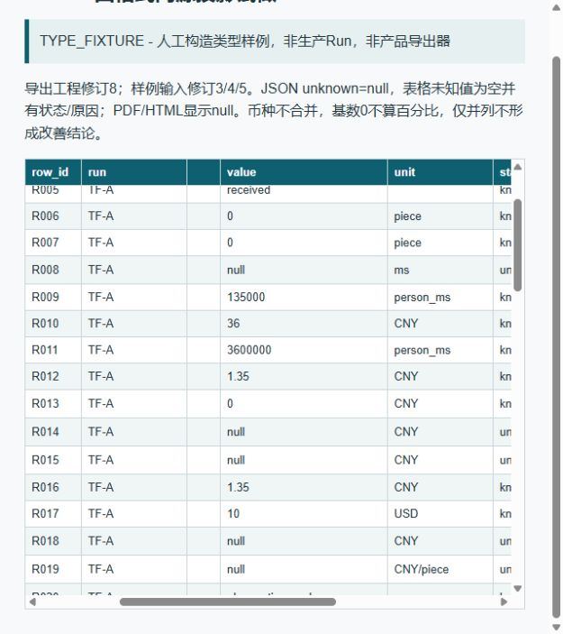
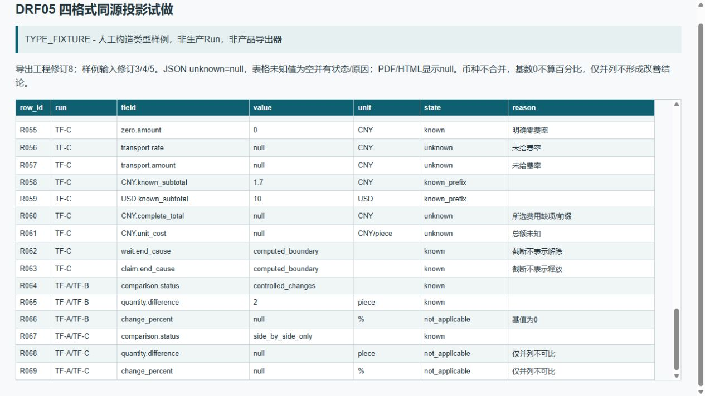

# DRF05 四格式与保存有限试做

2026-10-14。本轮r3已由窗口1合入：CostEvaluation.inputs/missing_conditions及InputChangeValue四快照变体。当前Rust、标准Schema与TS的19个载体/union检查、精确枚举与15组正反例全部匹配，字段同步剩余0；本窗口未重新生成或编译公共源。详情见[消费者复核](DRF05_消费者复核.json)。

## 同一type_fixture的实际文件投影

[输入/输出JSON](DRF05_四格式试做/output/evaluation.type_fixture.json)为schema_version=1.0的EvaluationReport，已经当前evaluation.schema.json标准验证。逐Run均为type_fixture，ID为TF-A/B/C；结构字段simulation_evaluation只用于类型呈现，不能通过产品ActualSoftware准入。没有实际生产Run、库存、Engine/Host/Commands调用。

|实际产物|实做证据|
|---|---|
|[JSON](DRF05_四格式试做/output/evaluation.type_fixture.json)|实际写出并重新解析；报告结构与同次输入一致，保留原Option null和精确数量/费率。|
|[CSV](DRF05_四格式试做/output/evaluation.type_fixture.csv)|UTF-8 BOM/CRLF；69行实际DictReader读回，与共享投影逐单元一致；未知值空字段并有state/reason，0仍为已知0。|
|[HTML](DRF05_四格式试做/output/evaluation.type_fixture.html)|当前In-app Browser通过新授权的127.0.0.1只读HTTP实际呈现，69行DOM逐单元与CSV匹配；1280/640窗口、横向滚动、2倍页面放大、前缀和比较尾行已实际截图。修复窄窗口单位断行/表头丢失。|
|[PDF](DRF05_四格式试做/output/pdf/evaluation.type_fixture.pdf)|ReportLab参考路径实际生成4页，pypdf读回69行字段，PDFium实际加载/渲染，AI逐页检查中文/换行/数值/页脚，无裁切、重叠或缺字。|

同一报告只产生一份共享行投影，四输出器不从另一份业务结果重新取值。冻结输入修订分别3/4/5，当前导出工程修订8；费率36/72保存在各Run.costs.inputs中，不取当前Scenario。费用1.35/2.7/1.7 CNY与10 USD分列，缺运输价格时完整总额/单位成本均null；明确零价为0。TF-C为50000ms前缀而非100000ms全窗，结束原因为computed_boundary；TF-A/B全窗仍未解除/释放的端帽为observation_end。

TF-A→TF-B基值0，可显示绝对数量差2piece但百分比null；TF-A→TF-C接受阶段与已知范围不同，只并列，差值/百分比均null。以上数字均为人工类型样例，未得生产改善、工业成本或目标达标结论。各PDF页和HTML顶部明确标注TYPE_FIXTURE。原E01—E12/HFC01—14数值未改。

产物详情：[projection-result.json](DRF05_四格式试做/projection-result.json)。PDF预览图在output/preview，实际图像复核是AI文件走查；用户本人/目标使用者/另一机器证据仍空。Codex PDF面板请求返回queued，未据此声称面板已显示；文件实际读回/渲染证据来自pypdf/PDFium。

### HTML真实浏览器收口

[html-browser-result.json](DRF05_四格式试做/html-browser-result.json)保留原file://拒绝，并记录本轮新增明确授权的受限HTTP试做。服务只允许GET/HEAD自建HTML，非白名单404、写方法405；登记TCP27855并绑定127.0.0.1，结束已核对PID/启动时间后停止、端口无监听。窗口2的TCP8921/PID49712保持监听。

初始640px窗口将person_ms单位断开，纵向滚动后表头离开视口。只在拥有者HTML/生成脚本改为表格自身滚动、固定列宽、固定表头及row_id/run两列，数值/单位/状态不换行；其他三格式未重生。实际横向滚动后可读值、币种及原因；末行仍显示表头和逐Run身份。2倍放大为CDP页面scale=2，恢复为1；640px另测重排。Ctrl+Equal未生效，不计作浏览器UI缩放通过。视口覆盖已重置，自建标签已关闭。





## 保存参考与原12实试分开

[save-reference-result.json](DRF05_四格式试做/save-reference-result.json)来自[有限参考脚本](../../../packages/reporting/save_commit.reference.py)，只在逻辑目标上验证先接收7/8、先准备8/7、仍按7/8提交，及6个终态：保存R7而当前R8仍dirty、R8保存完成变clean、替换失败恢复成功仍Failed/IoFailure、恢复失败不声称旧根完好、提交前取消、提交胜过取消。脚本没有目录键解析、文件写入/替换、Windows故障注入或Host保存。

既有[原12 I/O实试结果](../../../tools/type-contract-proof/output/persistence-proof-result.json)作为独立来源读取，evidence_kind为isolated_type_fixture_IO_not_product_Save_Open_or_software_handoff。本轮未重跑、更改或扩充这12项证明范围；尤其不能由原替换失败案例或本次布尔参考状态宣称1176/1177等新恢复路径已在Windows实测。

新增[save-contact-result.json](DRF05_四格式试做/save-contact-result.json)来自[两项隔离文件脚本](../../../packages/reporting/save_contact.proof.py)，在自建临时工程执行真实Windows文件调用，单独记录，不并入前述6项逻辑参考或原12项：

1. 两线程请求准入7→8、真实文件准备8→7；同一自建目录按7→8调用ReplaceFileW并重开根/ProjectState，最终R8。R7提交后当前R8的dirty值只按修订比较得到，未观察产品UI/TaskState。
2. 自建R7根持有不分享DELETE的真实CreateFileW句柄，替换为已准备R8得到GetLastError=32；旧根字节/清单/工程仍为R7，R8 pending保留，句柄已关闭。本例未执行1176/1177、旧根丢失或恢复操作。

各代、旧清单保留文件与pending均留在DRF05_四格式试做/save-contacts供检查。这只补齐所列文件接点；Host实际目录键解析、产品Save/Open和16软件交接情景仍待实做。

工程[16接手情景](../../../scenarios/模板与交接/expected-template-handoff.design.json)全部actual_result=null。生成器已由窗口1保留refinement_ref/drf05_handoff_cases/refinement_generation_note；本窗口没有运行覆写生成器。真正另目录/另一机器软件打开、修改、保存和重跑仍须P2-03/P5-01实做。

## 实际命令与剩余入口

既有bundled Python路径：C:/Users/fujunye/.cache/codex-runtimes/codex-primary-runtime/dependencies/python/python.exe。未安装依赖、改锁或推送发布；本次受限临时端口已释放。

```powershell
& 'C:/Users/fujunye/.cache/codex-runtimes/codex-primary-runtime/dependencies/python/python.exe' packages/reporting/evaluation_projection.proof.py
& 'C:/Users/fujunye/.cache/codex-runtimes/codex-primary-runtime/dependencies/python/python.exe' packages/reporting/save_commit.reference.py
& 'C:/Users/fujunye/.cache/codex-runtimes/codex-primary-runtime/dependencies/python/python.exe' packages/reporting/save_contact.proof.py
python docs/04_开发与验收/特征细化/DRF05_复核增量消费者.py
```

重新生成PDF后须重新做图像复核，脚本不自动填视觉通过。新增设计决策缺口0；剩余实际证据为选定printpdf/桌面产品导出接点、Host实际目录键并发/Windows恢复、16软件交接情景/跨机与本人接受。原17SF/21P/60S/Q01—64及阶段门不变。
